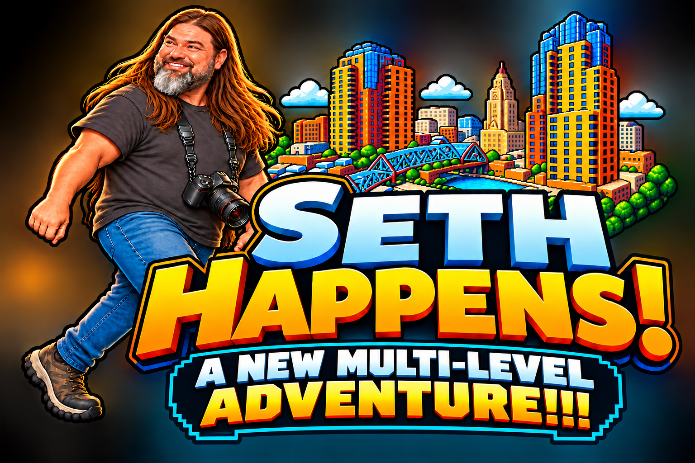
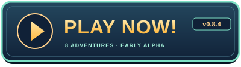

# Seth Happens - A New Adventure

**Version 0.13.0 · Early alpha**

  

**Play version 0.13.0** — Fullscreen highly recommended.

**Playing on a phone or tablet?** Add the game to your Home Screen and launch **Seth Happens 2** in landscape for the best mobile experience. Choose Default arrows, Sliding Speed Runner or Game Stick and save your preferred setup. See [How to add as a mobile app](#how-to-add-as-a-mobile-app).

One very ordinary guy. Twelve increasingly unreasonable adventures. One curtain call.

Run, jump, dodge and ride through a city full of familiar faces and questionable decisions. Pick up dinner, survive a scooter ride with Allison, photograph a concert, escape a haunted house, and find out just how badly a Wisconsin snow day can go.

🎵 **[Listen to the entire video game soundtrack](https://suno.com/playlist/6f596364-f5aa-4fea-8732-fde11fe15526)**.

## Fun things to explore

- Complete each adventure to unlock the next, then replay your favorites.
- Unlock each level's soundtrack and try it on earlier adventures.
- Try alternate routes, Mega Jumps and the rooftop easter egg.
- Customize touch controls and your unlocked soundtrack selections.
- Watch for Allison's reactions on the scooter ride.

## Your adventures

| Level | Adventure | Your mission |
| --- | --- | --- |
| 1 | Rooftop Beer Run | Climb 26 rooftops, take the photos and deliver the beer. |
| 2 | Thai Takeout Run | Collect dinner and bring it home through busier streets. |
| 3 | Scooter Ride | Tackle bigger ramps with Allison still aboard. |
| 4 | Concert Chaos | Get your press pass, reach the photo pit and get the shots. |
| 5 | Haunted House | Find the attic key and escape before the house catches up. |
| 6 | Zombie Apocalypse | Survive the neighborhood, find a truck and drive to safety. |
| 7 | Snow Day From Hell | Cross icy streets and dodge snowplows to reach warmth. |
| 8 | Carnival Catastrophe | Search for Allison across moving rides and a chaotic midway. |
| 9 | Cabin Fever | Cross the lake, collect the beer and bring it back to the cabin. |
| 10 | Grocery Store Gauntlet | Dodge runaway carts, collect three shopping-list items and make it through checkout. |
| 11 | Soccer Game Hijinx | Navigate the stadium, reach the sidelines and photograph the players, tunnel entrance and two big goals. |
| 12 | Last Call | Retrieve your camera bag, dodge the closing-time chaos and reach the exit before time runs out. |
| 13 | Encore · View-only finale | Watch the full cast cross the stage and bow, with Allison followed by Seth. Replay anytime once unlocked. |

Levels 1–12 are playable now. Level 13 is an early prototype of the view-only curtain-call finale, unlocked by finishing Last Call. Complete each available level to unlock the next. Once unlocked, replay any adventure from **Choose Level** in the desktop controls or mobile game menu.

## Playtest and jukebox

Normal play uses **Choose Level** and respects your saved unlocks. Developer playtesting is hidden from normal navigation; local development and owner-provided testing links support isolated review without saving scores or unlocks. [Playtest behavior and limitations](docs/playtest.md).

Open **Credits/Jukebox** from the controls or mobile menu for the afterparty and music player. Your unlocked tracks are available, plus the default **Eye of the Stairwell (Leads Take Me Away!)**. Your run stays paused until you resume.

## Controls

| Action | Keyboard | Controller | Touch |
| --- | --- | --- | --- |
| Move | A / D or ← / → | Left stick / D-pad | On-screen arrows or chosen movement control |
| Jump | W / ↑ / Space | A / Cross | Jump |
| Mega Jump | Double-tap Jump | Double-press Jump | Double-tap Jump |
| Sprint | Shift | RT / R2 | Customize movement controls in the menu |
| Interact / photograph | F | X / Square | Action |
| Pause | P | Menu / Options | Game menu |
| Restart | Hold R or Restart button | Use the game menu | Menu → Restart |

On the scooter and in the truck, **left brakes** and **right accelerates**. Ramps launch the scooter automatically. The level's opening screen explains special objectives and controls.

Full screen is recommended. An optional controller can be paired before play; use keyboard or touch for menus and score entry.

## How to add as a mobile app

1. Open **[Play Now](https://natsteff.github.io/seth-happens-a-new-adventure/)** in Safari.
2. Choose **Share → Add to Home Screen**. Enable **Open as Web App** if offered, then tap **Add**.
3. Launch **Seth Happens 2** from its icon and rotate to landscape.

Use the on-screen movement, Jump and Action controls. Open the game menu to adjust controls, change music, restart or choose a level.

The original **Seth Happens** can stay installed separately. This game has its own icon, name and progress. The default Home Screen label is **Seth Happens 2**; the full game title remains **Seth Happens - A New Adventure**. Existing installations may retain their old label. You can edit the name when adding a shortcut; preserve important records before removing any installation.

Android players can use the browser's **Install app / Add to Home screen** option. Internet is required; offline play is not included.

## Music and sound

Sound effects and music have separate controls. Choose a track with the radio, or open the mobile game menu for music settings.

New players start with **1 · Arcade Staircase**. Completing a level unlocks the next adventure and its soundtrack. Each unlocked song is selectable on any unlocked level.

| Track / level | Soundtrack |
| --- | --- |
| 1 · Rooftop Beer Run | Arcade Staircase |
| 2 · Thai Takeout Run | Thai Food Run |
| 3 · Scooter Ride | Scooter Run |
| 4 · Concert Chaos | Eye of the Stairwell (Leads Take Me Away!) |
| 5 · Haunted House | The Haunted Happy Hour |
| 6 · Zombie Apocalypse | The Beer of Destiny |
| 7 · Snow Day From Hell | Twenty-Six Floors of Celts |
| 8 · Carnival Catastrophe | Go Seth Go |

Cabin Fever reuses **Arcade Staircase** by default; it has no additional soundtrack unlock.

Each level starts with its assigned song unless you choose another unlocked track for that level. That choice is remembered across replays and future visits, independently for every level. Existing saved choices retain their song identity where unlocked; a newly locked choice falls back to the level's assigned song. Sound/music mute and volume preferences stay in effect.

Keyboard **1–8** selects the corresponding unlocked song, **0** turns music off, and **[ / ]** moves through unlocked songs. On mobile, choose music in the game menu. The countdown always uses **The Final Warning**; successful finishes use **26 Floors of Glory**. Failure and shortcut music keep their existing behavior.

## Progress and records

Unlocks, high scores and settings are saved in your browser. No account is required. They do not sync between devices, and browser and Home Screen installations may keep separate records. Clearing site data can remove them.

Every adventure has its own score list. This game keeps its saves separate from the original Seth Happens.

## Help test the game

Found a problem? [Report a bug](https://github.com/natsteff/seth-happens-a-new-adventure/issues) with the level, what happened, what you expected, and your device/browser. A screenshot helps, especially for touch controls or landing problems.

## Credits

Music: **[BT-AI](https://suno.com/@bt_ai)**. Selected sound effects: **[Pixabay](https://pixabay.com/sound-effects/)**. Voice production: **[ElevenLabs](https://elevenlabs.io/)**. Built with **[Phaser](https://phaser.io/)**.

See [asset and dependency notices](THIRD_PARTY_NOTICES.md) for credits and third-party rights. This is a fictional comedy adventure with no official team, band or venue affiliation.

